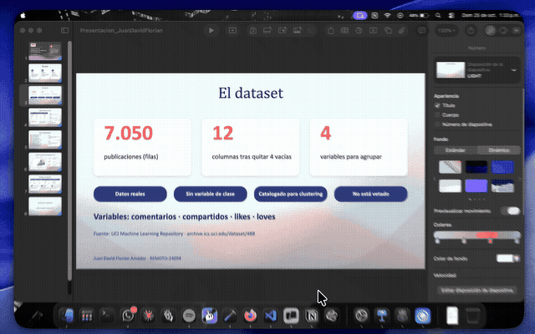

<div align="center">


&nbsp;&nbsp;&nbsp;&nbsp;<b>✕</b>&nbsp;&nbsp;&nbsp;&nbsp;


# Guino

### El teleprompter que vive en tu notch.

Lee tu guion justo debajo de la cámara, sin abrir otra ventana y sin perder el contacto visual.

<br>

[](dist/Guino-1.0.dmg)


<br>



</div>

---

> [!IMPORTANT]
> **Disponibilidad:** por ahora Guino está disponible **únicamente para MacBook Neo**. La compatibilidad con otros modelos de Mac se irá ampliando en próximas versiones (consulta la [hoja de ruta](#-hoja-de-ruta)).

## 📑 Contenido

- [Qué es Guino](#-qué-es-guino)
- [Para quién es](#-para-quién-es)
- [Cómo funciona](#-cómo-funciona)
- [Características](#-características)
- [Requisitos](#-requisitos)
- [Instalación](#-instalación)
- [Controles](#-controles)
- [Modos de avance](#-modos-de-avance)
- [Personalización](#-personalización)
- [Permisos y privacidad](#-permisos-y-privacidad)
- [Capturas de pantalla y videollamadas](#-capturas-de-pantalla-y-videollamadas)
- [Arquitectura](#-arquitectura)
- [Hoja de ruta](#-hoja-de-ruta)
- [Empaquetado y distribución](#-empaquetado-y-distribución)
- [Preguntas frecuentes](#-preguntas-frecuentes)
- [Uso responsable](#-uso-responsable)

## ✨ Qué es Guino

Guino es un teleprompter nativo para macOS que presenta el guion directamente debajo de la cámara mediante una barra compacta inspirada en el notch de MacBook. Así puedes leer con naturalidad durante reuniones, clases, presentaciones y grabaciones, manteniendo la mirada cerca del lente y sin abrir otra ventana de teleprompter en la pantalla.

Guino dibuja una barra oscura centrada en el borde superior de la pantalla. El texto avanza automáticamente según una velocidad o mientras detecta que estás hablando.

## 🎯 Para quién es

| | |
|---|---|
| 💻 **Videollamadas** | Presenta con seguridad en reuniones de trabajo. |
| 🎓 **Docentes y estudiantes** | Clases, cursos en línea y exposiciones. |
| 🎬 **Creadores de contenido** | Graba videos mirando a la cámara. |
| 🎤 **Ponentes** | Ponencias y presentaciones profesionales. |

## ⚙️ Cómo funciona

La interfaz tiene dos estados:

1. **Modo compacto:** muestra una o dos líneas del guion, los controles esenciales y el avance actual.
2. **Panel desplegado:** permite editar el guion, ajustar velocidad y estilo, controlar el audio y navegar manualmente.

Guino puede avanzar sin depender del micrófono, usando palabras por minuto. También puede entrar en modo de voz: se detiene cuando hay silencio y continúa mientras detecta habla.

## 🚀 Características

**Lectura**
- Barra compacta centrada debajo de la cámara, con esquinas inferiores redondeadas.
- Presentación de una o dos líneas.
- Indicador del avance actual.

**Avance**
- Avance automático por velocidad (palabras por minuto).
- Avance controlado por actividad de voz.
- Pausa y reanudación manual.
- Navegación anterior y siguiente.
- Desplazamiento manual mediante arrastre vertical, conservando la posición seleccionada.

**Edición y estilo**
- Editor de guion con vista previa de texto.
- Tamaño, grosor y color de letra.
- Ancho de la barra configurable.
- Sensibilidad del micrófono ajustable.
- Guardado persistente del guion y de los ajustes.

**Control y privacidad**
- Atajos globales.
- Acceso desde la barra de menú.
- Modo seguro sin contenido visible.
- Exclusión de captura mediante `sharingType = .none`.

## 📋 Requisitos

- **Dispositivo:** MacBook Neo (por ahora).
- macOS 14 o posterior.
- Permiso de micrófono (solo para el modo por voz).

**Para desarrollar:**
- Xcode 15 o posterior.
- [XcodeGen](https://github.com/yonaskolb/XcodeGen) para regenerar el proyecto.
- Apple Silicon recomendado.

## 📦 Instalación

### Opción 1: Descargar la app

1. Descarga [Guino-1.0.dmg](dist/Guino-1.0.dmg).
2. Ábrelo y arrastra **Guino** a la carpeta **Aplicaciones**.
3. Abre Guino desde Aplicaciones o Launchpad.

### Opción 2: Compilar desde el código

```bash
git clone <URL-DEL-REPOSITORIO>
cd guino
xcodegen generate
open Guino.xcodeproj
```

En Xcode:

1. Selecciona el esquema `Guino`.
2. Selecciona tu Mac como destino.
3. Ejecuta con `Cmd + R`.

También puedes compilar desde la terminal:

```bash
xcodebuild \
  -project Guino.xcodeproj \
  -scheme Guino \
  -configuration Debug \
  build CODE_SIGNING_ALLOWED=NO
```

## ⌨️ Controles

| Acción | Control |
|---|---|
| Mostrar u ocultar el panel | Doble clic sobre el notch |
| Pausar o reanudar | Botón play/pausa o `Option + Space` |
| Mostrar u ocultar modo seguro | `Option + H` |
| Desplegar o cerrar el panel | `Option + D` |
| Línea anterior | Botón Anterior o arrastre hacia abajo |
| Línea siguiente | Botón Siguiente o arrastre hacia arriba |

## 🔄 Modos de avance

### Avance por velocidad

El teleprompter avanza cada cierto intervalo según las palabras por minuto configuradas y el contenido de la línea actual. Este modo funciona sin activar el micrófono.

### Avance por voz

Al activar el micrófono, el avance solo se produce mientras Guino detecta voz y se detiene después de un breve período de silencio. La sensibilidad se ajusta desde el panel.

Al detener el micrófono, Guino vuelve automáticamente al modo por velocidad.

### Navegación manual

Puedes mover el guion hacia adelante o hacia atrás en cualquier momento. La posición seleccionada se mantiene como punto actual y el avance automático continúa desde allí.

## 🎨 Personalización

Desde el panel desplegado puedes configurar:

| Ajuste | Detalle |
|---|---|
| Texto | El guion de tu presentación |
| Velocidad | Palabras por minuto |
| Tamaño de letra | Ajustable |
| Peso de la fuente | Regular, medio, semibold o bold |
| Color | Líneas principales |
| Opacidad | Líneas siguientes |
| Ancho | Del notch |
| Líneas visibles | Una o dos |
| Sensibilidad | Del micrófono |

## 🔒 Permisos y privacidad

Guino solicita acceso al micrófono **solamente** para el detector de voz. La detección se realiza en tu equipo: el audio no se sube ni se envía a servidores de Guino.

Para cambiar el permiso:

1. Abre **Ajustes del Sistema**.
2. Entra en **Privacidad y seguridad > Micrófono**.
3. Habilita o deshabilita Guino.

También puedes acceder a la configuración desde el menú de la barra.

## 🎥 Capturas de pantalla y videollamadas

Guino solicita excluir su panel de las capturas mediante:

```swift
sharingType = .none
```

> [!WARNING]
> Esta configuración funciona en muchas apps de videoconferencia, pero **no garantiza** que la barra desaparezca en todas las situaciones. macOS y algunas aplicaciones pueden ignorar esta señal.

**Antes de compartir o grabar:**

- [ ] Activa el modo seguro (`Option + H`).
- [ ] Prueba Zoom, Meet o Teams con tu versión de macOS.
- [ ] Comprueba QuickTime, OBS y grabadores basados en ScreenCaptureKit.
- [ ] Haz capturas de prueba antes de una presentación importante.

## 🏗️ Arquitectura

El proyecto se organiza por responsabilidades:

```text
Guino/
├── GuinoApp.swift
├── AppDelegate.swift
├── Core/
│   ├── TeleprompterEngine.swift
│   ├── VoiceActivityDetector.swift
│   └── HotkeyManager.swift
├── Window/
│   ├── NotchPanel.swift
│   └── NotchWindowController.swift
├── Views/
│   ├── NotchView.swift
│   ├── NotchShape.swift
│   └── ControlPanelView.swift
└── Resources/
```

| Componente | Responsabilidad |
|---|---|
| `NotchPanel` | Ventana flotante de AppKit |
| `NotchWindowController` | Posicionamiento y cambios de tamaño |
| `TeleprompterEngine` | Guion, posición, velocidad y pausas |
| `VoiceActivityDetector` | Medición de audio y actividad de voz |
| `HotkeyManager` | Eventos globales |
| `NotchView` | Presentación compacta |
| `ControlPanelView` | Configuración y edición |

## 🗺️ Hoja de ruta

| Versión | Tema | Estado |
|---|---|---|
| **1.0** | Primera versión funcional | ✅ Disponible |
| **1.1** | Texto y navegación | 🔜 Próximamente |
| **1.2** | Detección de voz | 📅 Planeada |
| **1.3** | Seguimiento inteligente | 📅 Planeada |
| **1.4** | Gestión de guiones | 📅 Planeada |
| **1.5** | Sesiones de presentación | 📅 Planeada |
| **2.0** | Aplicación distribuible | 📅 Planeada |

<details>
<summary><b>Versión 1.1 — Texto y navegación</b></summary>

- División automática de párrafos largos por ancho real.
- Ajuste exacto de líneas completas dentro de la barra.
- Preferencia por saltos naturales entre frases.
- Scroll suave con trackpad y rueda.
- Indicador de posición dentro del guion.
- Atajos arriba y abajo para cambiar de línea.

</details>

<details>
<summary><b>Versión 1.2 — Detección de voz</b></summary>

- Calibración automática del ruido ambiente.
- Perfiles de sensibilidad.
- Histéresis configurable.
- Indicador visual de nivel de audio.
- Selección de dispositivo de entrada.
- Estados de permiso más claros.

</details>

<details>
<summary><b>Versión 1.3 — Seguimiento inteligente</b></summary>

- Transcripción local opcional con Speech.
- Alineación de voz y guion palabra por palabra.
- Soporte para repeticiones, omisiones e improvisaciones.
- Corrección automática de posición al hablar.
- Seguimiento entre líneas largas.

</details>

<details>
<summary><b>Versión 1.4 — Gestión de guiones</b></summary>

- Varios guiones guardados.
- Crear, duplicar, renombrar y eliminar guiones.
- Importar TXT y Markdown.
- Exportar guiones.
- Buscador dentro del guion.
- Marcadores y notas por diapositiva.

</details>

<details>
<summary><b>Versión 1.5 — Sesiones de presentación</b></summary>

- Temporizador de presentación.
- Tiempo estimado según velocidad.
- Palabras por minuto reales.
- Porcentaje de progreso.
- Historial básico de ensayos.
- Modo ensayo sin micrófono.

</details>

<details>
<summary><b>Versión 2.0 — Aplicación distribuible</b></summary>

- Icono oficial.
- Pantalla de bienvenida.
- Asistente de permisos.
- Preferencias generales.
- Firma y notarización de Apple.
- Actualizaciones integradas.
- Soporte para varios monitores y **otros modelos de Mac**.
- Perfiles para distintas cámaras y ubicaciones.

</details>

<details>
<summary><b>Ideas futuras</b></summary>

- Sincronización de guiones con iCloud.
- Temas visuales.
- Soporte para varios idiomas.
- Notas privadas fuera de la barra principal.
- Teleprompter remoto desde iPhone.
- Integración con Presentaciones y Keynote.
- Perfiles automáticos según la aplicación activa.
- Detección de cámara y ajustes por posición.
- Mejora de brillo y contraste sobre fondos claros.

</details>

### Registro de cambios

| Versión | Cambios |
|---|---|
| **1.0.0** | Primera versión funcional: notch compacto, avance por velocidad y por voz, editor y personalización, atajos y modo seguro. |
| **1.1.0** *(propuesto)* | Navegación manual mejorada, división inteligente del guion, scroll compacto. |
| **1.2.0** *(propuesto)* | Mejor detector de voz, selección de micrófono, calibración ambiental. |
| **1.3.0** *(propuesto)* | Seguimiento por reconocimiento de voz. |
| **2.0.0** *(propuesto)* | Varios guiones, empaquetado, firma y distribución completa. |

## 📤 Empaquetado y distribución

Para uso personal, ejecutar desde Xcode es suficiente.

Para distribución pública:

1. Configura un Apple Developer Team.
2. Define un identificador de bundle definitivo.
3. Firma la aplicación.
4. Archiva con `Product > Archive`.
5. Exporta la aplicación.
6. Realiza la notarización con Apple.
7. Distribuye el DMG o paquete firmado.

> [!NOTE]
> La firma y la notarización requieren una cuenta de desarrollador de Apple y pueden variar según la versión de macOS y Xcode.

## ❓ Preguntas frecuentes

<details>
<summary><b>¿En qué Macs funciona Guino?</b></summary>

Por ahora, únicamente en MacBook Neo. Se planea ampliar la compatibilidad a otros modelos en futuras versiones.

</details>

<details>
<summary><b>¿Necesito activar el micrófono?</b></summary>

No. El avance por velocidad funciona sin micrófono. Solo lo necesitas si quieres que el guion avance mientras hablas.

</details>

<details>
<summary><b>¿Mi audio se envía a algún servidor?</b></summary>

No. La detección de voz se hace en tu equipo y el audio no se sube ni se envía a servidores de Guino.

</details>

<details>
<summary><b>¿Los demás pueden ver el guion cuando comparto pantalla?</b></summary>

Guino pide a macOS que excluya su panel de la captura, y funciona en muchas apps. Sin embargo, no está garantizado en todos los casos, así que usa el modo seguro y haz una prueba antes de presentar.

</details>

<details>
<summary><b>¿Cómo oculto el contenido rápidamente?</b></summary>

Presiona `Option + H` para activar el modo seguro.

</details>

## 🤝 Uso responsable

Guino está diseñado para apoyar presentaciones, clases, videos y reuniones transparentes. Su uso debe respetar las reglas de entrevistas, evaluaciones, procesos académicos y situaciones donde leer un guion pueda estar prohibido o constituir una práctica engañosa.

Guino debe presentarse como una herramienta de comunicación y preparación, no como un mecanismo para ocultar información en contextos donde la autenticidad y el conocimiento propio sean requisitos esenciales.

---

<div align="center">

Hecho con ❤️ para quienes quieren hablar con confianza.

</div>